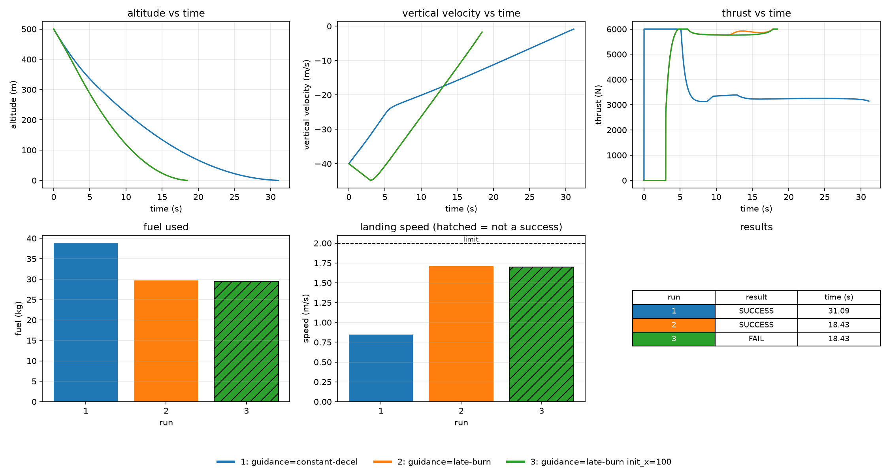
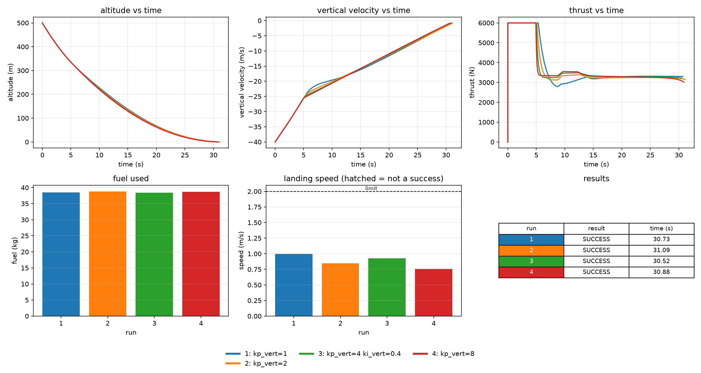

# Landing Guidance Simulator

A 2D powered-descent simulator in C++ that lands a lander on a pad using two interchangeable guidance laws and a PID controller, then lets you run several setups on the same scenario and compare them in plots.



The figure shows three runs on the same scenario: constant-deceleration guidance (blue), late-burn guidance (orange), and late burn starting 100 m off the pad (green, hatched), which misses.

## Why

Landing a rocket involves two separate problems. Guidance decides what the descent should look like, and control makes the vehicle follow it. This project keeps those two layers apart, so a guidance law can be swapped without touching the controller, and different laws or controller gains can be compared on identical conditions.

## What it does

- **Physics:** a point-mass lander in 2D with a throttleable, tiltable engine, mass that falls as fuel burns, and semi-implicit Euler integration.
- **Guidance laws:**
  - `constant-decel`: follows a fixed braking curve `v = -sqrt(v_td^2 + 2*a*h)`.
  - `late-burn`: coasts, then brakes as hard as the engine allows (with a safety factor).
- **Control:** a vertical PID on velocity (with gravity feedforward, throttle limits and anti-windup) and a horizontal loop that steers the tilt toward the pad.
- **Touchdown evaluation:** exact ground-contact speed by interpolation, judged against limits on landing speed, sideways speed and distance from the pad.
- **Configurable:** every setting can come from a config file or command-line flags, with validation and clear errors.
- **Multi-run comparison:** several runs in one command, each logged to CSV, with a summary table and an overlay plot.

## Requirements

- A C++17 compiler (`g++`)
- Python 3 with `matplotlib` and `numpy` for the plots: `py -m pip install matplotlib numpy` (or `pip install matplotlib numpy`)

## Build

From the repo root, create the folders git ignores (`build/` for programs, `data/` for output) and compile.

PowerShell:

```powershell
New-Item -ItemType Directory -Force build, data
g++ -std=c++17 -Wall -Wextra src/main.cpp src/lander.cpp src/logger.cpp src/guidance.cpp src/pid.cpp src/controller.cpp src/touchdown.cpp src/config.cpp src/runner.cpp -o build/lander.exe
```

Linux or macOS:

```bash
mkdir -p build data
g++ -std=c++17 -Wall -Wextra src/*.cpp -o build/lander.exe
```

If you have `make`, running `make` builds the same thing.

## Run

A single landing with the default Moon scenario:

```powershell
./build/lander.exe
```

```
guidance: constant-decel, gravity 1.62 m/s^2
Result: SUCCESS
time:           31.09 s
landing speed:  0.85 m/s (limit 2.00)
sideways speed: 0.00 m/s (limit 1.00)
miss distance:  0.00 m (limit 5.00)
fuel used:      38.82 kg
log written to: data/run.csv
```

Plot that run (altitude, velocity, thrust and mass):

```powershell
py scripts/plot_run.py data/run.csv
```

### Change settings

Settings go on the command line (`--name value` or `--name=value`) or in a config file, with flags overriding the file and the file overriding the defaults:

```powershell
./build/lander.exe --guidance late-burn --init_altitude 800
./build/lander.exe --config configs/mars.cfg
```

A config file is one `key = value` per line, with `#` for comments:

```
gravity = 3.71
max_thrust = 9000
mdot_max = 3.0
guidance = late-burn
```

`configs/moon.cfg` and `configs/mars.cfg` are ready to use. `./build/lander.exe --help` lists every setting and its default. Invalid values (a zero time step, a misspelled setting) are reported with a clear message and nothing runs.

### Compare several runs

Each `--run "key=value key=value"` is one extra simulation that changes those settings on top of the rest. Keep the quotes:

```powershell
./build/lander.exe --run "guidance=constant-decel" --run "guidance=late-burn"
./build/lander.exe --run "kp_vert=1" --run "kp_vert=2" --run "kp_vert=4 ki_vert=0.4" --run "kp_vert=8"
```

```
run label                    result     time(s)  landing(m/s)  sideways(m/s)   miss(m)   fuel(kg)
1   guidance=constant-decel  SUCCESS      31.09          0.85           0.00      0.00      38.82
2   guidance=late-burn       SUCCESS      18.43          1.71           0.40      0.55      29.69
```

Every run is saved as `data/run_N.csv` and `data/summary.csv` holds one row per run. Overlay them all:

```powershell
py scripts/plot_compare.py
py scripts/plot_compare.py --save docs/data/screenshots/compare.png
```

## Results

All figures are for the default Moon scenario (500 m up, 50 m off the pad, descending at 40 m/s). The full experiments, with commands and tables, are in [docs/guidance_notes.md](docs/guidance_notes.md).

- **Late burn saves fuel and time.** About 9.1 kg and 12.7 s less than constant deceleration (29.69 kg and 18.43 s against 38.82 kg and 31.09 s), but it lands harder (1.71 m/s against 0.85 m/s, with a 2.0 m/s limit).
- **Late burn cannot steer from far off.** Starting 100 m from the pad it misses by 32.8 m, while constant deceleration still lands on target.
- **Late burn has little margin.** Planning to brake at the engine's limit (`burn_safety = 1.0`) crashes at 11.62 m/s, while 0.7 to 0.9 all land.
- **PID gains barely matter on the default scenario.** Four gain sets land within 0.6 s, 0.25 m/s and 0.5 kg of each other.



## Tests

The tests are plain C++ programs with no framework. Each prints PASS or FAIL per check and a total. This script builds and runs all of them (PowerShell):

```powershell
powershell -ExecutionPolicy Bypass -File scripts/run_tests.ps1
```

With `make` installed, `make test` does the same. To build one test by hand, for example:

```powershell
g++ -std=c++17 -Wall -Wextra -Isrc tests/test_system.cpp src/lander.cpp src/guidance.cpp src/pid.cpp src/controller.cpp src/touchdown.cpp -o build/test_system.exe
./build/test_system.exe
```

| Test | Covers |
| --- | --- |
| `test_physics` | equations of motion, fuel use, engine limits |
| `test_guidance` | both guidance laws |
| `test_pid` | PID output, clamping, anti-windup, reset |
| `test_controller` | throttle and tilt commands |
| `test_touchdown` | interpolation and success limits |
| `test_config` | parsing, validation, config files, `--run` specs |
| `test_runner` | multi-run building, logs, summary file |
| `test_system` | whole flights: fuel and thrust invariants, time-step convergence, mirror symmetry, free fall |

The source files each test needs are listed in `scripts/run_tests.ps1` and the `Makefile`.

## Project structure

```
landing-guidance-sim/
├── configs/
│   ├── mars.cfg
│   └── moon.cfg
├── docs/
│   ├── data/
│   │   ├── data_sets/
│   │   │   ├── run.csv
│   │   │   ├── run_1.csv ... run_4.csv
│   │   │   └── summary.csv
│   │   └── screenshots/
│   │       ├── compare.png
│   │       ├── gain_sweep.png
│   │       └── run.png
│   └── guidance_notes.md
├── scripts/
│   ├── plot_compare.py
│   ├── plot_run.py
│   └── run_tests.ps1
├── src/
│   ├── config.cpp / config.hpp
│   ├── controller.cpp / controller.hpp
│   ├── guidance.cpp / guidance.hpp
│   ├── lander.cpp / lander.hpp
│   ├── logger.cpp / logger.hpp
│   ├── main.cpp
│   ├── params.hpp
│   ├── pid.cpp / pid.hpp
│   ├── runner.cpp / runner.hpp
│   └── touchdown.cpp / touchdown.hpp
├── tests/
│   ├── test_config.cpp
│   ├── test_controller.cpp
│   ├── test_guidance.cpp
│   ├── test_physics.cpp
│   ├── test_pid.cpp
│   ├── test_runner.cpp
│   ├── test_system.cpp
│   └── test_touchdown.cpp
├── .gitignore
├── LICENSE
├── Makefile
└── README.md
```

`build/` (compiled programs) and `data/` (CSVs from your own runs) are created locally and ignored by git. `docs/data/data_sets/` holds saved output CSVs for reference.

## Limitations

- The lander is a point mass in 2D. There is no rotation, no angular dynamics and no gimbal lag: it tilts instantly to whatever angle it is commanded, up to a limit.
- Flat ground, constant gravity, no atmosphere.
- The controller sees the exact state, with no sensor noise or delay.
- Mass flow is exactly proportional to throttle.
- The findings come from a small set of scenarios and describe this simulator, not guidance laws in general.

## License

MIT, see [LICENSE](LICENSE).
